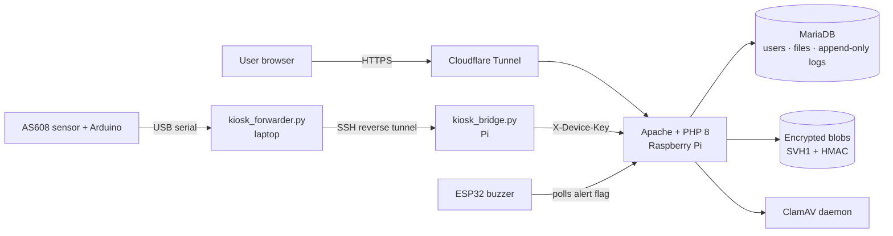

# SecureVault

**Secure file storage with fingerprint step-up verification and real-time intrusion detection.**
Final Year Project (CBS/09/24B), Diploma in Cyber Security Technologies, German-Malaysian Institute.

Live: **[securevault.com.my](https://securevault.com.my)**

SecureVault is a self-hosted file vault for organisations that handle sensitive documents, such as clinics and bank branches. It runs on a Raspberry Pi behind Cloudflare Tunnel. Every upload is scanned for malware, then encrypted and integrity-tagged before it touches the disk. Downloading or deleting a file needs a physical fingerprint scan, and repeated attacks lock the account and set off a hardware alarm.

---

## Security mechanisms

| # | Mechanism | How it is enforced |
|---|-----------|--------------------|
| 1 | **Encryption at rest** | AES-256-CBC with a random IV per file and an HMAC-SHA256 tag (encrypt-then-MAC). Stored format: `SVH1 ‖ ciphertext ‖ tag`. A tampered file is refused (HTTP 409) and raises an intrusion alert. |
| 2 | **Key management** | The key is not in the code. Apache passes it from a root-only config file (`SetEnv AES_KEY_HEX`), and the app refuses to start without it. |
| 3 | **Malware scanning** | Every upload goes through ClamAV (`clamdscan`) *before* it is encrypted or stored. Infected files are rejected and logged. |
| 4 | **Fingerprint step-up (MFA)** | Downloads and deletes need a live scan on an AS608 sensor. Templates are stored encrypted with AES-256-GCM, and no fingerprint image ever leaves the kiosk. |
| 5 | **Bank-style fingerprint policy** | An admin does the first enrolment. Changing a fingerprint needs the owner's old finger or the admin's own finger. An admin replacing a user's fingerprint starts a cooling-off period that blocks downloads and deletes. |
| 6 | **Role-based access control** | Accounts are created by an admin (no open sign-up). Only the owner of a file can download or delete it, and admins cannot read users' files. |
| 7 | **Intrusion detection & lockout** | 5 failed passwords or fingerprint scans lock the account, log an intrusion and trigger an ESP32 buzzer over WiFi. |
| 8 | **Append-only audit log** | MariaDB triggers block `UPDATE`/`DELETE` on `activity_logs` and `intrusion_alerts`. Deleting a user keeps their history (`ON DELETE SET NULL`). |

## Architecture



**Fingerprint verify flow:**
1. The browser asks `fingerprint_verify_start.php` for a one-time token.
2. `kiosk_bridge.py` polls `fingerprint_device_poll.php` and receives the job with the stored template.
3. The Arduino matches the live finger against that template *on the sensor* and reports MATCH or NOMATCH with a score.
4. The server checks the token and minimum score, then releases the download.

## Repository layout

All source code is in the [`securevault/`](securevault) folder:

```
securevault/
  web/          PHP application (served from /var/www/html)
    api/        JSON endpoints (auth, files, fingerprint, alerts, admin)
    config/     db.php, crypto.php (AES + HMAC), auth_guard.php
  kiosk/        kiosk_forwarder.py (laptop) + kiosk_bridge.py (Pi) + start_kiosk.bat
  firmware/     Arduino AS608 kiosk sketch, ESP32 buzzer sketch
  sql/          Extra tables, migrations, append-only log triggers
  tools/        Sensor test script, local alert watcher
```

## Tech stack

PHP 8 · MariaDB · Apache · Raspberry Pi OS · Cloudflare Tunnel · ClamAV · Python 3 (pyserial) · Arduino (AS608) · ESP32 · vanilla JS/CSS

## Setup (summary)

1. Copy `securevault/web/` to the web root and create the `secure_file_storage` database. Then run the scripts in `securevault/sql/` in this order: `access_requests.sql`, `fingerprint_db_templates.sql`, `migrations.sql`, `logs_append_only.sql`.
2. Copy `securevault-secrets.conf.example` to `/etc/apache2/conf-available/securevault-secrets.conf`, fill in your own keys (`openssl rand -hex 32`), `chmod 600`, then `a2enconf securevault-secrets`.
3. Install ClamAV: `sudo apt install clamav-daemon`.
4. Flash `securevault/firmware/fingerprint_kiosk` to the Arduino and set `DEVICE_KEY` in `securevault/kiosk/kiosk_bridge.py`.
5. Optionally flash `securevault/firmware/esp32_buzzer` with your WiFi details and `BUZZER_KEY`.

> No keys, passwords or user data are included in this repository. Every secret has a `CHANGE_ME` placeholder or is read from the server environment.

## Team

- Wan Muhammad Hakimi
- Siti Darwisyah
- Adam Wafiq

Supervisor: Mohamad Aiman Hanif Apandi

---
*Academic project. Not intended for production use without an independent security review.*
